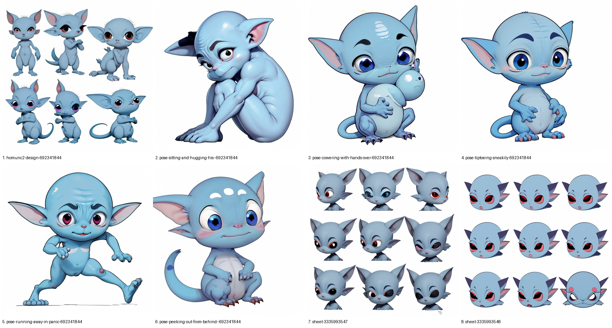

# custom-stable-diffusion 🧪

A local Stable Diffusion setup built around **ComfyUI**, run headless and driven by Claude via ComfyUI's HTTP API. You describe what you want; Claude writes the prompt, queues the job, looks at the result, and iterates. The ComfyUI node editor is still there at http://127.0.0.1:8188 if you want to poke at it yourself.

Also home to a small, blue, deeply anxious (and lately very grumpy) homunculus, who is currently being DeepDreamed.



## Quick start

```sh
./setup.sh        # one time: clones ComfyUI + nodes at pinned commits, installs deps, downloads ~11GB of models
./start.sh        # starts ComfyUI on http://127.0.0.1:8188
```

Then, in another terminal:

```sh
PY=ComfyUI/.venv/bin/python

# SDXL (Juggernaut XL), photoreal-leaning, 1024x1024
$PY scripts/gen.py "a red fox in fresh snow at golden hour" -n 2
$PY scripts/gen.py "a cozy cabin at night" --fast          # DMD2 speed LoRA

# SD1.5 (DreamShaper 8), better for cartoony stuff, and what AnimateDiff uses
$PY scripts/gen.py "cute cartoon blue homunculus..." --ckpt dreamshaper_8.safetensors \
    --width 512 --height 512 --steps 25 --cfg 7 --seed 692341844

# IPAdapter: keep him on-model by passing reference images
$PY scripts/gen.py "cute cartoon blue homunculus creature, side view walking, very grumpy..." \
    --ckpt dreamshaper_8.safetensors --width 512 --height 512 --steps 25 --cfg 7 \
    --ref refs/homunculus-crouch.png refs/homunculus-armscrossed.png --ref-weight 0.7

# img2img: restyle an existing image; --denoise 0 = unchanged, 1 = ignore it
$PY scripts/gen.py "...everything in cool blue tones..." --fast --init outputs/<image>.png --denoise 0.6

# tile a bunch of images into one labeled sheet
$PY scripts/contact.py outputs/sheets/whatever.png outputs/*-homunc3-*.png

# animation tools (see "Grumpy dream walk" below)
$PY scripts/patterns.py sheets                                   # background pattern option sheets
$PY scripts/patterns.py fill outputs/<background>.png            # animated vortex flow in its dark void
$PY scripts/dreamwalk.py outputs/*grumpy-walk-*.png --hold 5     # DeepDreamed walk cycle (first pass)
```

Every image lands in `outputs/` next to a `.json` with its full recipe (prompt, negative, seed, sampler, model…), so anything can be reproduced or riffed on.

## What's in here

| Path | What |
|---|---|
| `setup.sh` | Rebuilds the whole ComfyUI install from scratch, pinned to exact commits |
| `start.sh` | Launches the ComfyUI server |
| `scripts/gen.py` | Text-to-image and img2img (`--init`): builds a ComfyUI graph, queues it, saves PNG + JSON. Stdlib only |
| `scripts/contact.py` | Makes contact sheets for reviewing batches |
| `scripts/patterns.py` | Blue procedural backgrounds; animated vortex-lattice loop; fills a background's void with it |
| `scripts/dreamwalk.py` | Cuts the homunculus out of renders, walks him through a scene, shatters him, DeepDreams every frame |
| `refs/` | IPAdapter reference images of the homunculus |
| `outputs/` | Everything generated so far, with recipes |
| `outputs/animations/` | Rendered loops (mp4/gif) and `wip/` sheets from the animation experiments. Frame dumps are gitignored |
| `ComfyUI/` | *(gitignored, ~13GB)* ComfyUI, its venv, custom nodes, and models |

### Models

| Model | Base | Used for |
|---|---|---|
| Juggernaut XL v9 | SDXL | General / photoreal images |
| DMD2 4-step LoRA | SDXL | `--fast` mode (6 steps, cfg 1) |
| DreamShaper 8 | SD1.5 | Cartoony / stylized; the homunculus |
| AnimateLCM (motion module + LoRA) | SD1.5 | Fast AnimateDiff animation *(installed, not yet used)* |
| IP-Adapter Plus + CLIP ViT-H image encoder | SD1.5 | `--ref`: character consistency from reference images |
| GoogLeNet / Inception v1 (torchvision, auto-downloads ~50MB) | n/a | DeepDream, the original "everything is dogs" network |

### Custom nodes

ComfyUI-Manager, ComfyUI-AnimateDiff-Evolved, ComfyUI-VideoHelperSuite, ComfyUI_IPAdapter_plus.

## Hardware reality check

Running on an **M1 Pro, 16GB** via PyTorch's MPS backend. Measured times:

| Job | Time |
|---|---|
| SDXL, 30 steps, 1024² | ~3.5 min (first run, includes model load) |
| SDXL `--fast`, 6 steps | ~55s (about 20s sampling; the rest is memory shuffling, since 16GB is tight) |
| SD1.5, 25 steps, 512² | ~21s (~25s with IPAdapter) |
| SDXL `--fast` at 1344×768, after SD1.5 was loaded | 3+ min: model swapping under memory pressure |
| DeepDream, 768×432, 5 octaves × 15 iters | ~4–5s per frame on MPS |

SDXL is about the ceiling here. Flux, Wan 14B and friends technically run but would take many minutes per image. For serious video, rent a cloud GPU.

## The homunculus saga (so far)

The goal: an original nervous little blue homunculus. He's *inspired by* the vibe of a certain anxious MTG character but deliberately his own design, to stay clear of anyone's IP.

1. **Round 1:** four different style takes. One great result (peeking over books), one that drew a sad human boy instead, and one that looked like a screaming shark.
2. **Round 2:** locked the character description (bald round head, big pointy ears, huge frightened eyes, thin tail). Way more consistent. The **design sheet, seed `692341844`**, became the favorite.
3. **Round 3:** dialed up the fear and put him in situations (teacup, potion accident, storm). Adorably scared, but SD1.5 mostly ignored the props: no cat, no lantern, and the spellbook became two orbs.
4. **Pose variations:** same seed + prompt with only the pose swapped. Style holds; proportions and expression drift. Good, but not truly the *same* guy every time.

**Lesson:** prompt tricks get you "same species," not "same character."

5. **IPAdapter:** added `--ref` to `gen.py`. Feeding the crouch + arms-crossed refs (`refs/`) at weight 0.5 vs 0.75 across five poses ([sheet](outputs/sheets/ipadapter.png)): now it's recognizably *him* every time. 0.75 is more on-model; 0.5 lets the pose prompt win more often.
6. **Grumpy walk cycle:** six side-view "grumpy, scowling, stomping" walks at ref weight 0.7 (`*-grumpy-walk-*`). All face right with very furrowed brows: a usable stomp cycle.

## Grumpy dream walk (animation, in progress)

The idea: the grumpy homunculus stomps along looping, arching roads through a void with a wild procedural background, while his body comes apart into drifting pieces, and the whole thing is DeepDreamed (the 2015 Google thing that turned everything into dogs). Work-in-progress sheets live in [`outputs/animations/wip/`](outputs/animations/wip/).

### Pass 1: procedural everything (`scripts/dreamwalk.py`)

- **Cutout:** flood-fill the white background from the borders (so eye whites survive), drop big enclosed white pockets (the gap between his legs), keep the largest blob.
- **Discombobulation:** each sprite is Voronoi-split into ~9 pieces that fly apart and wobble on a pulsing envelope, then snap back together.
- **Scene:** Julia-set void, glowing trochoid loop-de-loop roads, and an aqueduct road he walks on. Everything is periodic in the loop length, so the video loops seamlessly.
- **DeepDream:** gradient ascent on GoogLeNet `inception4c` + `inception4d` over 5 octaves. Each frame starts from the previous dreamed frame, warped by optical flow, so the hallucinations ride the motion instead of flickering. Feedback is reduced on the character so his face stays readable. 30 warm-up frames are dreamed before frame 0 so the loop wraps cleanly.
- **Gotcha worth remembering:** torchvision's `googlenet` expects `_transform_input()` to run before `conv1`. Calling the layers directly skips it, and you get mushy crosshatch instead of eyes and dogs. With the fix you get the real thing: eyeballs, lizard-dogs, pagodas ([sweep](outputs/animations/wip/4-dream-settings-sweep.png)).

The procedural roads were too flat and garland-like, so the scene is being reworked (below).

### Pass 2: bone halls + procedural void

- **Background art:** SDXL backgrounds of bone-white ribbon walkways, lattice webbing and teal liquid, curving from the far distance into the foreground. Inspired by the mood of *Slay the Spire*'s Winding Halls but described in our own words, not copied. The first try drew an asphalt highway with lane lines (`*-bonehalls-*`), so the prompt now insists the walkway itself is bone and negative-prompts asphalt and road markings (`*-bonepath-*`).
- **Void pattern:** explored [six blue procedural patterns](outputs/animations/wip/5-background-patterns.png), then [four "structured" versions](outputs/animations/wip/6-structured-flow.png) where flow and ink follow a hidden lattice. Picked **C, the vortex lattice**: a hex grid of alternating-spin vortices steering streamlines.
- **Animation trick:** streamlines are traced once. Each segment also writes a phase into a per-pixel phasor buffer, so per frame a single rotation slides light pulses down every line. Add slowly cycling marbled ink and a periodic breathing warp, and it loops seamlessly in under 0.1s per frame.
- **Fill:** `patterns.py fill` finds the background's void and animates the vortex flow into it ([loop](outputs/animations/bonehalls1-vortex.mp4)).
- **Masking, round 1:** brightness threshold, blurred. The blur smeared the mask across edges and painted swirls onto the road ([v1](outputs/animations/wip/7-bonehalls-vortex-fill.png)).
- **Masking, round 2:** hard threshold, drop specks, then fade *inward* only with a distance transform, so nothing bleeds onto the structure. That still caught the far end of the road, which is as black and smooth as the void itself (brightness ~0.02 vs ~0.01), so no pixel statistic can separate them. `--protect "x,y x,y …"` polygons (0–1 coords) mark regions that must never be filled ([v2: outline + composite](outputs/animations/wip/8-void-mask-v2.png)):
  ```sh
  $PY scripts/patterns.py fill outputs/20261107-193514-bonehalls-2292325229.png --protect "0,1 0,.74 .69,.515 .80,.515 .79,1"
  ```

- **All-bone retry** (`*-bonepath-*`, [batch](outputs/animations/wip/9-bonepath-batch.png)): #3, a looping lattice ribbon over teal, was the best of the batch ([fill](outputs/animations/wip/10-bonepath3-fill.png)). But the original arch road was still the favorite.
- **img2img on the favorite:** added `--init/--denoise` to `gen.py` and restyled the arch road "bony and blue" at 0.45 / 0.6 / 0.75 ([compare](outputs/animations/wip/11-bonehalls-blue-img2img.png)). 0.45 kept a lane line; 0.6 turned the road into wavy bone ribbons running into the arch tunnel; 0.75 put bone strips on a reflecting pool. DMD2 `--fast` smooths away fine lattice detail. A full 30-step pass or road-only inpainting would keep more.

### Pass 3: the reel

`dreamwalk.py --background` swaps the procedural scene for a generated image:

- The void gets the animated vortex lattice (`patterns.VortexLoop` + `void_mask`, with the floor protected).
- `--path "x,y,width …"` is a hand-traced walk from the tunnel mouth to the foreground. Points were found by scanning rows for bright ribbon spans. The walkway width at each point sets his scale, and he moves at constant *ground* speed (screen distance ÷ scale), so he speeds up on screen as he approaches, like real perspective.
- Sprites get `:flip` so he faces the way he's walking.
- To make the loop seamless, he reassembles out of flying pieces at the tunnel mouth, stomps toward the camera with a mild wobble, then blows apart and fades in the foreground.

Two versions to compare:

```sh
G=(outputs/*grumpy-walk-{1,2,4,5,6,3}-*.png); G=(${G/%/:flip})   # zsh

# denoise 0.6 background: wide bone ribbon to the bottom-left corner
$PY scripts/dreamwalk.py $G --hold 4 --name reel \
  --background outputs/20261107-195110-bonehalls-blue-d0.6-2292325229.png --protect "0,.55 1,.55 1,1 0,1" \
  --path "0.618,0.558,0.057 0.555,0.585,0.059 0.501,0.613,0.064 0.451,0.640,0.073 0.400,0.667,0.079 0.353,0.695,0.086 0.303,0.722,0.094 0.264,0.749,0.096 0.219,0.777,0.102 0.164,0.804,0.120 0.115,0.831,0.130"

# denoise 0.75 background: middle wavy ribbon over the reflecting pool
$PY scripts/dreamwalk.py $G --hold 4 --name reel75 \
  --background outputs/20261107-195231-bonehalls-blue-d0.75-2292325229.png --protect "0,.56 1,.56 1,1 0,1" \
  --path "0.658,0.583,0.039 0.625,0.611,0.043 0.592,0.639,0.047 0.560,0.667,0.049 0.527,0.694,0.057 0.495,0.722,0.062 0.458,0.750,0.068 0.423,0.778,0.073 0.391,0.829,0.078 0.354,0.856,0.083 0.318,0.884,0.086 0.289,0.912,0.091 0.258,0.940,0.096 0.234,0.968,0.102"
```

### Pass 4: water, stages, dream (0.75 background)

- **Water** (`--water 0.555` = horizon height): below the horizon, anything that isn't bone is water. Bone means bright pixels, plus dim colorless pixels connected to bright bone within ~25px, which catches shadowed bone. Small enclosed pockets (perforation holes) count as bone, and coral speckle is closed into solid clumps. The first, brightness-only mask rippled over shadowed ribbon ([before/after](outputs/animations/wip/16-water-mask-fix.png)).
- The water reflects the swirling void (mirrored about the horizon, fading with distance) and gets looping perspective waves, ring ripples that are born and die once per loop, and crest glints. Far-off waves are calmed and the depth is capped; otherwise they alias into stripes at the horizon.
- **Stage-by-stage renders** (`--no-character`, `--no-shatter`): [1 backdrop](outputs/animations/stage1-backdrop.mp4), [2 + walk](outputs/animations/stage2-walk.mp4), [3 + discombobulation](outputs/animations/stage3-shatter.mp4), [4 + DeepDream](outputs/animations/stage4-dream.mp4). All four play in sync in [stages-2x2.mp4](outputs/animations/stages-2x2.mp4) ([stills](outputs/animations/wip/17-stage4-dream.png)).
- **DeepDream result:** the bone ribbons turned into coral snakes, black dogs appear in the bottom-left, and eyes and machinery fill the void. Because frame-to-frame feedback locks hallucinations in place, the snakes ride the ribbons for the whole loop. The homunculus mostly gets dreamed away into a ghost. Next tweak: lower `--feedback`/`--step`, or a higher `--char-protect`.

### Pass 5: the procession (`scripts/procession.py`)

A 14-second clip that loops: an accelerating stream of homunculi comes out of the far end of the arch tunnel and down the middle ribbon. Each one is more discombobulated than the last, and they flicker in and out of existence while afterimage trails and DeepDream ramp up. At the end, everyone explodes past the frame edges and it all drains back to the empty opening frame.

```sh
G=(outputs/*grumpy-walk-{1,2,4,5,6,3}-*.png); G=(${G/%/:flip})
$PY scripts/procession.py $G --background outputs/20261107-195231-bonehalls-blue-d0.75-2292325229.png \
  --path "$(cat outputs/animations/wip/procession-path.txt)" --protect "0,.56 1,.56 1,1 0,1" --water 0.555 \
  --trip 7.5 --min-trip 4 --loop --dream-full 12.5 --dream-ease 1.4 --name procession-loop-slow
```

- **Timeline:** 1s of empty scene. Then walkers spawn with gaps shrinking from 1.6s by ×0.85 each time, down to 0.35s (~15 walkers). Discombobulation scales from 0 to 6, and later walkers are faster. Flicker hides walkers in 2-frame blips from 4s, up to ~50% hidden. Trails are a decaying premultiplied buffer of past character layers, tinted cyan.
- **Loop ending (`--loop`):** at 12.3s everyone still on screen explodes (staggered, pieces growing up to 8× and flung off-frame), while trails and dream drain over the last 0.8s. The vortex and water are periodic in the clip length, so frame 209 → 0 is seamless ([ending](outputs/animations/wip/22-loop-ending-raw.png)).
- **No more dogs.** The 4c/4d layers (`procession.mp4`) literally turned the finale into huskies. The [style sweep](outputs/animations/wip/24-dream-options.png) gave `dreamwalk.Dreamer` three new kinds of objective:
  - `inception4a` ("architecture"): eyes and filigree, no animals.
  - `guide:<layer>`: Google's guided-DeepDream objective. Each patch is pulled toward its best match among a guide image's features ([guided sweep](outputs/animations/wip/25-guided-dream.png)).
  - `class:A-B:w`: push toward or (negative w) away from ImageNet classes. `class:151-268:-1.2` is "no dog breeds".
- **Gremlin version:** guided at 4a+4b+4c by a [sheet of reference homunculi](outputs/animations/wip/guide-refsheet.png). Alone, that hallucinated dogs and lemurs ([sweep](outputs/animations/wip/27-gremlin-guided.png)); with a strong anti-dog term the creatures vanished ([sweep](outputs/animations/wip/28-gremlin-nodogs.png)). -1.2 is the sweet spot ([tune](outputs/animations/wip/29-gremlin-antidog-tune.png)): big-eyed furry gremlin-lemurs. It's ~5.6s/frame because the class term needs the full network.

| Version | Dream | Ramp |
|---|---|---|
| [procession-loop-slow.mp4](outputs/animations/procession-loop-slow.mp4) ⭐ | 4a + guide 4b (eyes, filigree) | 4s → full at 12.5s, eased late ([vs fast](outputs/animations/wip/32-fast-vs-slow-ramp.png)) |
| [procession-loop.mp4](outputs/animations/procession-loop.mp4) | same | 4s → full at 10s ([stills](outputs/animations/wip/30-loop-architecture.png)) |
| [procession-loop-gremlin.mp4](outputs/animations/procession-loop-gremlin.mp4) | gremlin-guided, anti-dog | 4s → full at 10s ([stills](outputs/animations/wip/31-loop-gremlin.png)) |
| [procession.mp4](outputs/animations/procession.mp4) | 4c/4d (dogs!), not a loop | 7s → 14s ([stills](outputs/animations/wip/23-procession-dream.png)) |
| [procession-loop-raw.mp4](outputs/animations/procession-loop-raw.mp4) | none | n/a |

Add `--no-dream` for a ~25s raw preview: [0.6 raw](outputs/animations/reel-raw.mp4) ([frames](outputs/animations/wip/12-reel-raw.png)), [0.75 raw](outputs/animations/reel75-raw.mp4) ([frames](outputs/animations/wip/13-reel75-raw.png)). The DeepDreamed versions take ~15 min each.

## Next up

- [x] **IPAdapter**: use the favorite image as a visual reference so every generation is *him*
- [ ] Finish the grumpy dream walk (see above)
- [ ] **AnimateDiff**: make him scurry around nervously (models already downloaded; needs an `animate.py`)
- [ ] Maybe train a character LoRA on the best ~15–20 images for real consistency
- [ ] Upscaling, img2img, inpainting as needed
