# How the procession loop was made

This covers the whole path from a text prompt to [procession-loop-slow.mp4](../outputs/animations/procession-loop-slow.mp4) and the gremlin versions. There are two halves:

1. **ComfyUI** makes the still images: the character, his walk-cycle poses, and the background.
2. **Python post-processing** (`scripts/dreamwalk.py`, `patterns.py`, `procession.py`) turns those stills into an animated, DeepDreamed loop. No diffusion model is involved in this half.

<p align="center">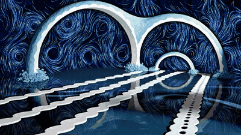</p>

<p align="center"><sub>procession-loop-slow (GIF preview; the full-quality <a href="../outputs/animations/procession-loop-slow.mp4">mp4</a> is in the repo)</sub></p>

```
 ComfyUI (Stable Diffusion)                         Python post-processing (numpy / OpenCV / torch)
 ─────────────────────────                          ──────────────────────────────────────────────
 [1] design sheet ──crop──▶ refs/*.png
                              │
 [2] IPAdapter walk poses ◀───┘ ──▶ 6 grumpy sprites ──▶ cutout ─▶ Voronoi shatter ─┐
                                                                                     ├─▶ composite per frame ─▶ trails ─▶ DeepDream ─▶ ffmpeg
 [3] SDXL bone-halls bg ──▶ [4] img2img "blue" ──▶ background ─▶ void mask + vortex ─┤      (procession.py)
                                                               └▶ water + ripples ───┘
```

## Part 1: ComfyUI

### The graphs

The four graphs that produced the final assets are in [`workflows/`](../workflows/). They were extracted from the PNGs themselves: ComfyUI's SaveImage node embeds the exact graph in every image, so any PNG in `outputs/` can be dragged onto the ComfyUI canvas to load the graph that made it. To export one as a file:

```sh
$PY scripts/export_workflow.py outputs/<image>.png workflows/<name>.json
```

The JSON is in ComfyUI's **API format**: nodes and links, but no canvas layout. Drag it onto the canvas (or use Workflow → Open) and ComfyUI arranges the nodes for you. You can also POST it straight to `/prompt`, which is what `scripts/gen.py` does. Re-running `1-character-design-sd15.json` gives the same image back. It isn't bit-identical, because the Apple GPU backend (MPS) isn't fully deterministic, but the mean pixel difference is about 1/255.

| Graph | Made | Model | Settings |
|---|---|---|---|
| [1-character-design-sd15.json](../workflows/1-character-design-sd15.json) | The design sheet (seed `692341844`) | DreamShaper 8 (SD1.5) | 512², 25 steps, cfg 7, dpmpp_2m / karras |
| [2-grumpy-walk-ipadapter-sd15.json](../workflows/2-grumpy-walk-ipadapter-sd15.json) | Grumpy walk pose #1 (the other five only differ in seed) | DreamShaper 8 + IP-Adapter Plus | Same, plus 2 reference images at weight 0.7 |
| [3-background-sdxl-dmd2.json](../workflows/3-background-sdxl-dmd2.json) | The original bone-halls background | Juggernaut XL v9 + DMD2 LoRA | 1344×768, 6 steps, cfg 1, lcm / sgm_uniform |
| [4-background-img2img-sdxl-dmd2.json](../workflows/4-background-img2img-sdxl-dmd2.json) | Graph 3's image restyled blue (the final background) | Same | img2img, denoise 0.75 |

All of them use the same basic chain: **Load Checkpoint → CLIP Text Encode (positive + negative) → Empty Latent → KSampler → VAE Decode → Save Image**. Each one changes that chain a little.

### 1. Find the character (txt2img)

Plain SD1.5 text-to-image. DreamShaper 8 handled cartoony characters much better than SDXL/Juggernaut here. It took three rounds of prompting (see the README's "homunculus saga") to lock in a description: *bald round head, big pointy ears, huge round frightened eyes, thin tail, character design sheet, white background*. The negative prompt does a lot of the work: `human, boy, girl, child, person, teeth, menacing` stops it from drawing a sad human kid.

The four images in [`refs/`](../refs/) are crops of single poses from this sheet, placed on 512² white canvases.

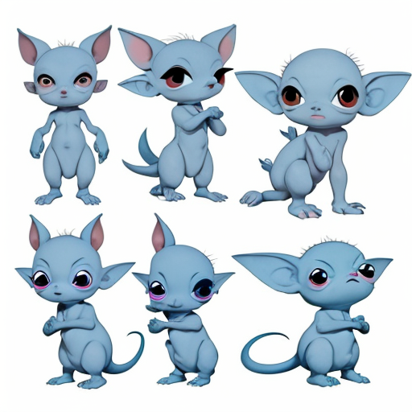 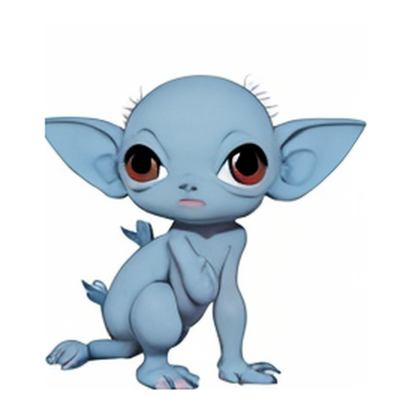 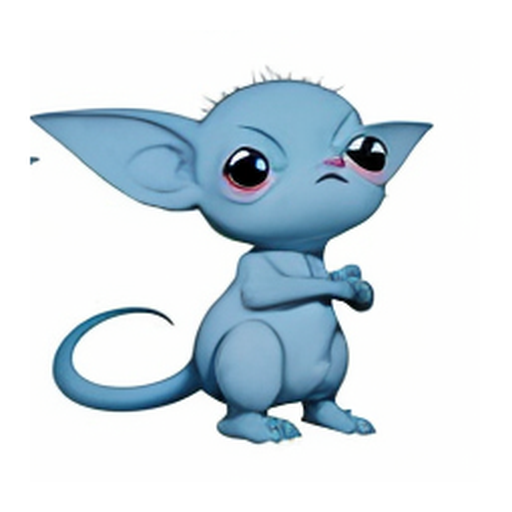

<sub>The design sheet, and two of the refs cropped from it.</sub>

### 2. Keep him on-model (IPAdapter)

Prompting alone gets you "the same species", not "the same character". IPAdapter fixes that by feeding reference images into the model alongside the text:

- **Load Image** ×2 (`homunculus-crouch.png`, `homunculus-armscrossed.png`) → **Image Batch**
- **IPAdapter Unified Loader** (preset *PLUS (high strength)*), which loads IP-Adapter Plus and the CLIP ViT-H image encoder
- **IPAdapter Advanced**: weight 0.7, `linear`, embeddings `concat`, scaling `V only`, active for the whole denoise (0 → 1)
- Its MODEL output goes into the KSampler in place of the checkpoint's MODEL

The refs carry the look, and the prompt carries the pose and mood: *side view walking, mid stride, very grumpy scowling face, stomping, white background, full body*. Weight 0.5 let the pose win more often; 0.75 was more on-model. 0.7 gave six usable side-view stomps (`outputs/*grumpy-walk-{1..6}-*`). The white background matters for Part 2, which cuts him out automatically.

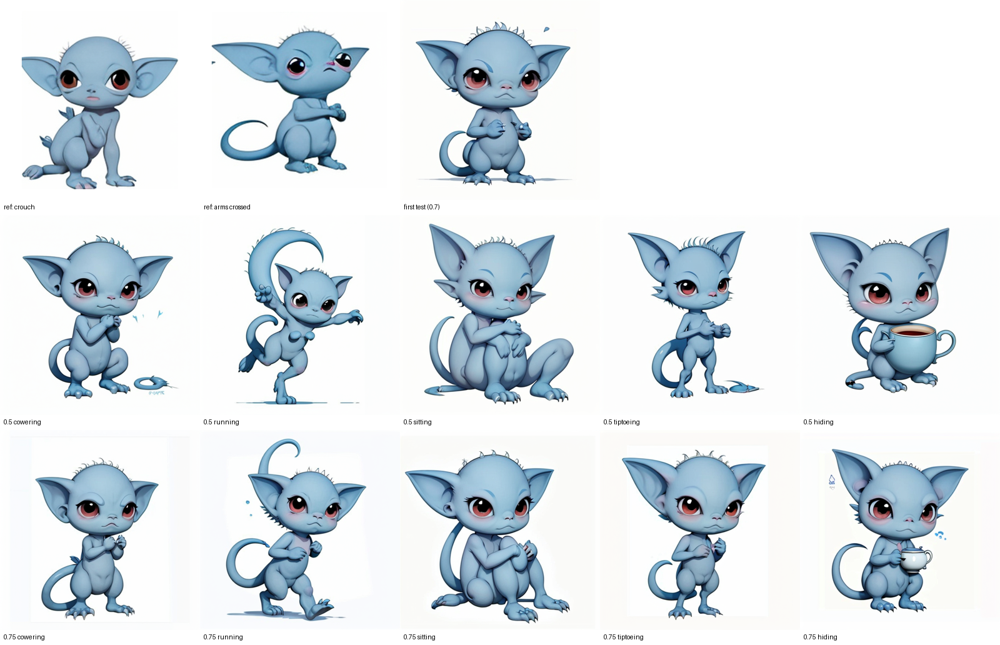

<sub>IPAdapter at weight 0.5 vs 0.75 across five poses.</sub>

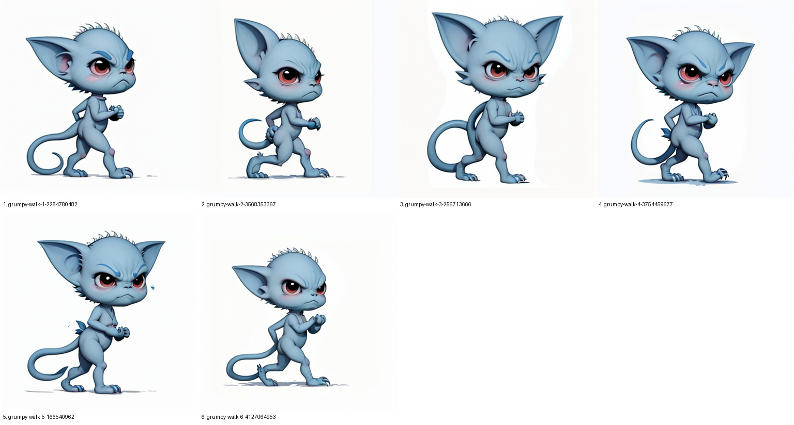

<sub>The six grumpy walk poses.</sub>

> To load graph 2 in the UI, first copy the two refs into `ComfyUI/input/` (`gen.py --ref` does this for you).

### 3. The background (SDXL + DMD2)

Juggernaut XL at 1344×768 with the **DMD2 4-step LoRA** (LoraLoader between the checkpoint and both the sampler and the text encoders). DMD2 is a distilled "speed" LoRA: 6 steps at cfg 1 with the `lcm` sampler instead of 30 steps at cfg 4.5. On this 16GB M1 that's about 55s instead of about 3.5 min. The trade-off is that fine detail gets smoothed away.

The prompt asks for *bone-white roads curving from the far distance into the foreground, arched ribbon bridges, lattice bone webbing, deep black background*. That black void matters: Part 2 finds it and animates it.

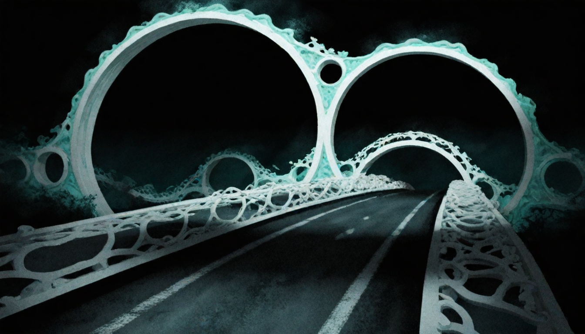

<sub>The original bone halls (graph 3). Good shapes, but the walkway still reads as asphalt.</sub>

### 4. Make it blue (img2img)

Same graph, except **Load Image → VAE Encode** replaces Empty Latent, so sampling starts from graph 3's picture instead of pure noise. KSampler `denoise` sets how much gets repainted: 0.45 kept a painted lane line, 0.6 gave wavy ribbons, and **0.75** (the one used) turned it into blue bone strips over a reflecting pool. The prompt switches to *cool blue tones, cobalt, cyan and navy*, and the negative prompt pushes away `asphalt, road markings, lane lines, teal, warm colors`.

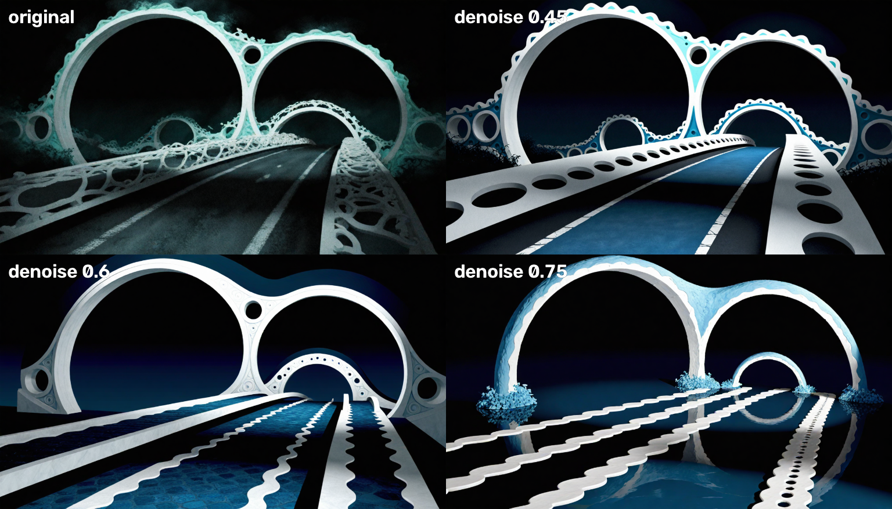

<sub>Denoise 0.45 / 0.6 / 0.75.</sub>

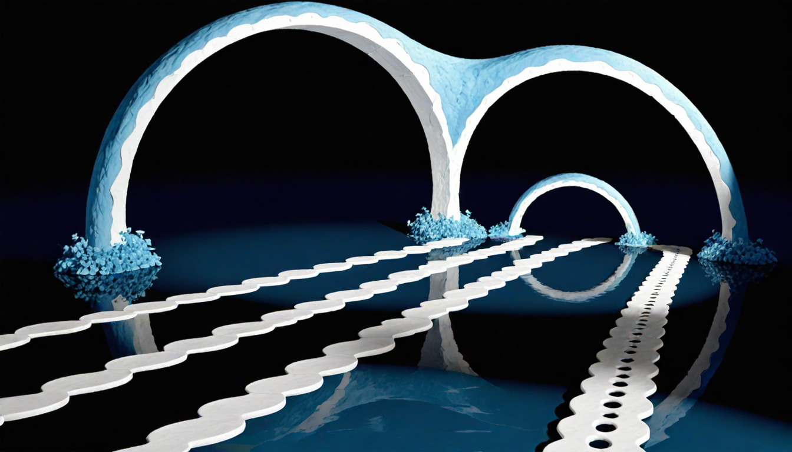

<sub>The 0.75 result (graph 4): the final background.</sub>

> To load graph 4 in the UI, copy `outputs/20261107-193514-bonehalls-2292325229.png` into `ComfyUI/input/`.

## Part 2: post-processing

Everything here runs in the ComfyUI venv (`PY=ComfyUI/.venv/bin/python`). The output is 768×432 at 15 fps: 14s, 210 frames.

### Character prep (`dreamwalk.cutout`, `dreamwalk.shatter`)

1. **Cutout.** Near-white pixels are flood-filled from the image borders, which removes the background but keeps enclosed whites like his eyes. Only the largest blob is kept. Big enclosed white pockets (the gap between his legs) are removed too. Then the mask is eroded by 1px and feathered, and the image is cropped to him.
2. **Flip.** `:flip` on a sprite path mirrors it so he faces the way he walks.
3. **Shatter.** Each sprite is Voronoi-split into 9 pieces around random seed points. Each piece flies outward from his center and has its own wobble and spin, so "discombobulation" is a single number (the envelope) that scales how far apart they go.

### Background prep (`patterns.py`, `dreamwalk.BackdropScene`, `dreamwalk.Water`)

4. **Void mask.** Dark pixels below a hard threshold, with small specks removed, faded *inward* with a distance transform so nothing bleeds onto the bone. The far end of the walkway is as dark and smooth as the void, so no pixel rule can tell them apart. `--protect` polygons mark areas that must never be filled.
5. **Vortex lattice.** A hex grid of vortices with alternating spin steers 1600 streamlines. They are traced once. Each segment writes a phase into a per-pixel phasor buffer, so each frame is a single rotation that slides light pulses down every line. Add slow marbled ink and a breathing warp, and you get an animated void in under 0.1s per frame. Everything repeats exactly once per clip, so it loops.
6. **Water** (`--water 0.555` = horizon height). Below the horizon, anything that isn't bone becomes water. "Bone" means bright pixels, plus dim colorless pixels that connect to bright bone, so shadowed bone stays bone. The water reflects the swirling void (mirrored, fading with distance) and gets looping perspective waves, ring ripples and crest glints. Waves are calmed near the horizon so they don't alias into stripes.

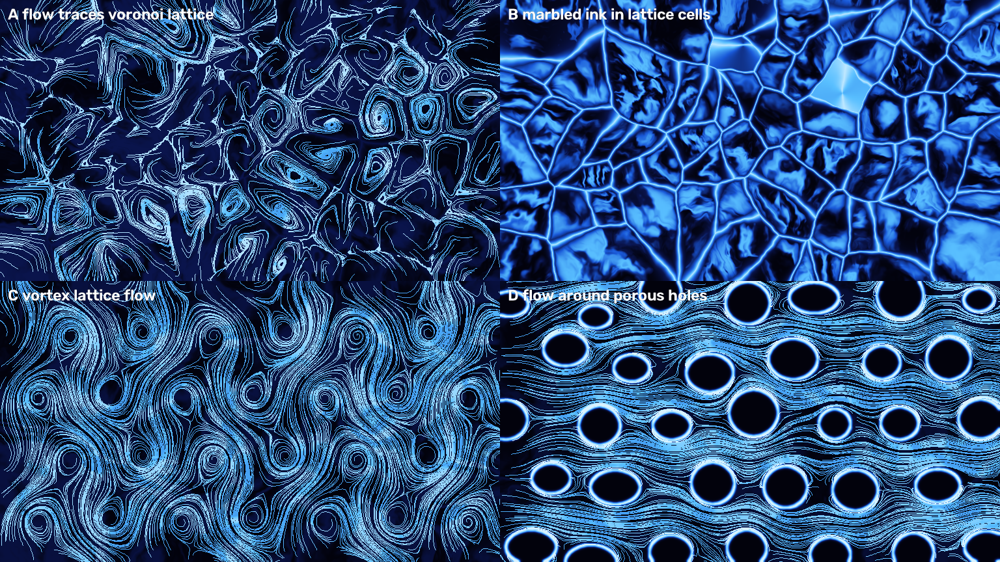

<sub>Pattern candidates. C, the vortex lattice, won.</sub>

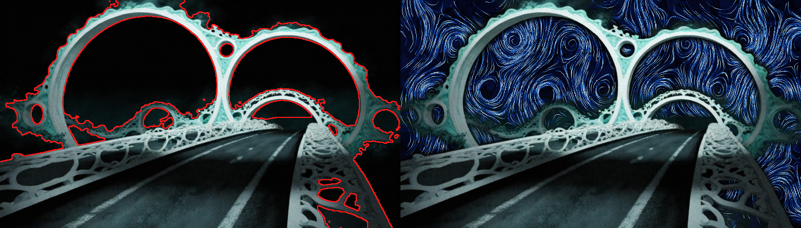

<sub>The void mask with the walkway protected: outline and composite.</sub>

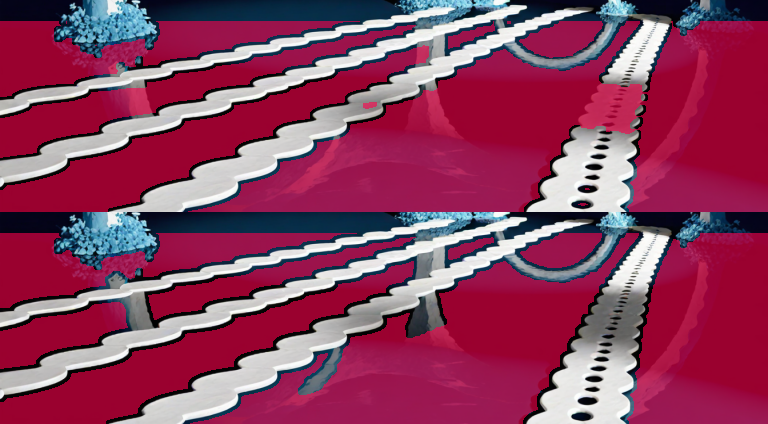

<sub>Water mask before and after counting shadowed bone as bone.</sub>

### Choreography (`procession.py`)

7. **Walk path.** `--path` is a hand-traced list of `x,y,width` points from the tunnel mouth to the foreground ([procession-path.txt](../outputs/animations/wip/procession-path.txt)). The walkway width sets his scale at each point. He moves at a constant *ground* speed, so he speeds up on screen as he gets closer, like real perspective.
8. **Timeline.** 1s of empty scene. Then walkers spawn with gaps starting at 1.6s and shrinking ×0.85 each time, down to 0.35s (~15 walkers). Each walker is faster (trip 7.5s → 4s) and more scrambled (level 0 → 6) than the last. Sprites cycle every 4 frames for the stomp, with a little bob.
9. **Flicker.** From 4s on, walkers vanish in 2-frame blips, building to about half hidden at any moment.
10. **Trails.** A decaying premultiplied buffer of past character layers, tinted cyan and drawn behind the live walkers.
11. **Loop ending** (`--loop`). At ~12.3s everyone still on screen explodes, staggered: pieces grow up to 8× and get flung past the frame edges. Then trails and dream drain away over the last 0.8s, so frame 209 matches frame 0.

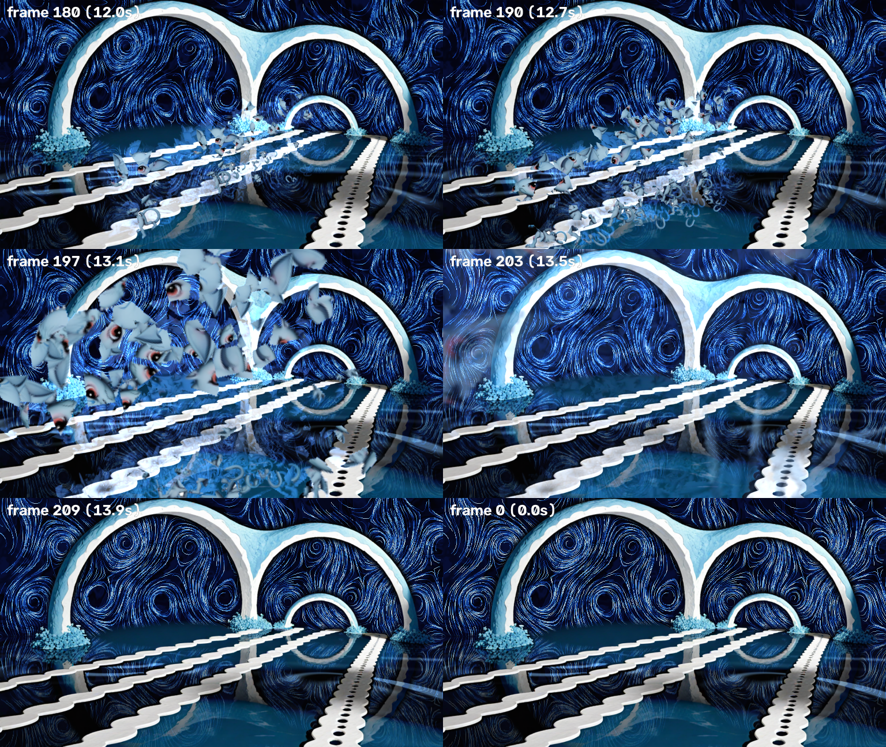

<sub>The loop ending, before DeepDream. All four build stages playing in sync: [stages-2x2.mp4](../outputs/animations/stages-2x2.mp4).</sub>

### DeepDream (`dreamwalk.Dreamer`)

12. **Gradient ascent on GoogLeNet** (torchvision's Inception v1) over 5 octaves × 15 iterations, with random jitter. Each frame starts from the previous *dreamed* frame, warped onto the current one with optical flow (`flow_warp`). That way the hallucinations follow the motion instead of flickering. Feedback is weakened on the characters (`--char-protect 0.75`) so they stay readable.
13. **Ramp.** Dream strength eases in from 4s to full at 12.5s (`--dream-ease 1.4` holds it back until late).
14. **Choosing what it hallucinates:**
    - `inception4c/4d`, the classic layers, turned the finale into huskies (`procession.mp4`).
    - `inception4a:1.0,guide:inception4b:6.0` (the default, used for ⭐ `-slow`): eyes and filigree, no animals. `guide:` is Google's guided-DeepDream objective: it pulls each patch toward its closest match in a guide image's features, here [a strip of grumpy homunculi](../outputs/animations/wip/guide-strip.png).
    - **Gremlin:** guided at 4a + 4b + 4c by [a sheet of reference homunculi](../outputs/animations/wip/guide-refsheet.png), plus `class:151-268:-1.2`, a negative push on ImageNet's dog-breed classes. Without the anti-dog term it dreamed dogs and lemurs. With it, you get big-eyed furry gremlins. It's ~5.6s/frame, because the class term needs the full network.
    - **Gotcha:** torchvision's `googlenet` expects `_transform_input()` before `conv1`. Calling the layers directly skips it, and you get mush instead of eyes.

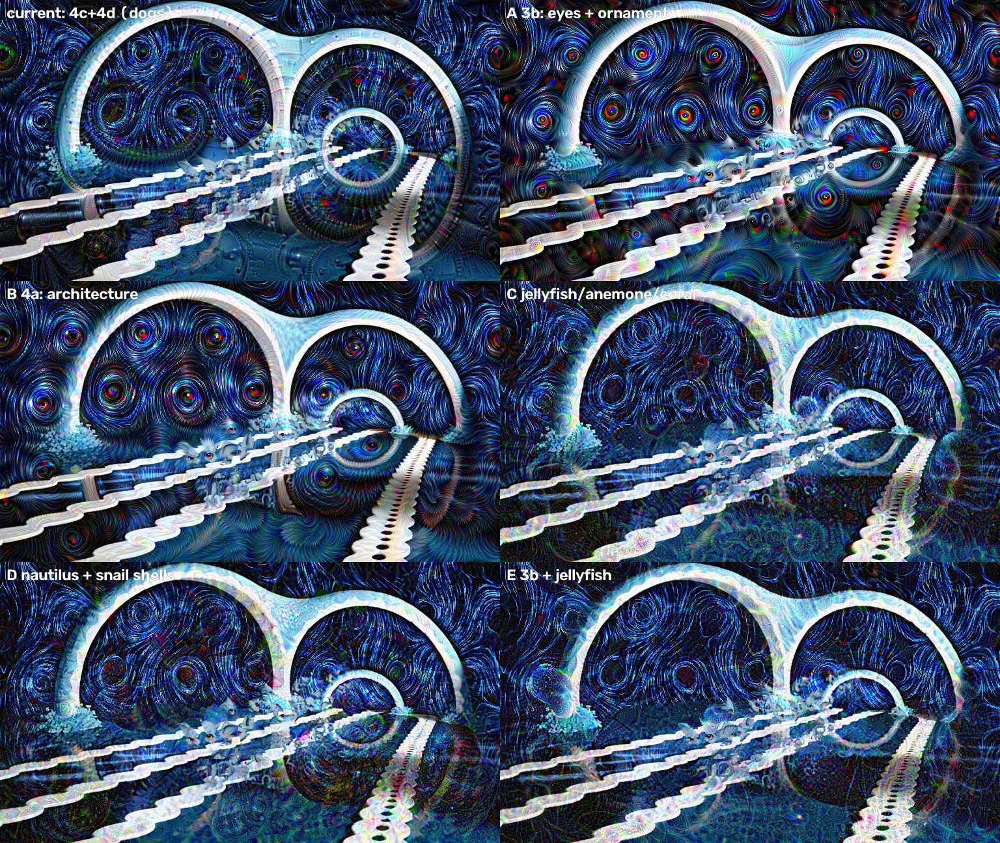

<sub>The layer sweep.</sub>

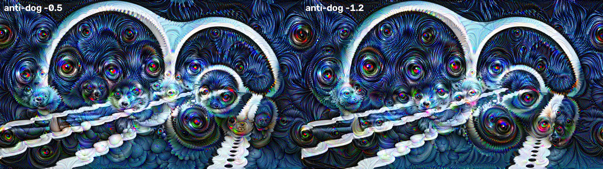

<sub>Tuning the anti-dog weight. −1.2 gave big-eyed gremlins.</sub>

### Encoding and the square crop

15. Frames are written as PNGs and then encoded with ffmpeg: x264, CRF 16, yuv420p. A 512px-wide palette GIF is made alongside.
16. **Square version.** A 432×432 crop at x=118. That window was picked by scoring each possible column offset on how much character motion it contains (frame differences of the raw render, minus the median column so the background swirl doesn't count). It keeps 96% of the motion. Then a lanczos upscale to 1080² for posting:
    ```sh
    ffmpeg -i outputs/animations/procession-loop-gremlin.mp4 -vf "crop=432:432:118:0,scale=1080:1080:flags=lanczos" \
      -c:v libx264 -crf 16 -pix_fmt yuv420p outputs/animations/procession-loop-gremlin-square-1080.mp4
    ```

<p align="center">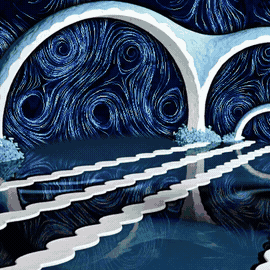</p>

<p align="center"><sub>The square gremlin version (GIF preview; <a href="../outputs/animations/procession-loop-gremlin-square-1080.mp4">1080² mp4</a>)</sub></p>

## Reproducing it

```sh
./setup.sh && ./start.sh             # ComfyUI + models, pinned
PY=ComfyUI/.venv/bin/python

# Part 1 (or load workflows/*.json in the UI)
$PY scripts/gen.py "<design-sheet prompt>" --ckpt dreamshaper_8.safetensors --width 512 --height 512 --steps 25 --cfg 7 --seed 692341844
$PY scripts/gen.py "<grumpy walk prompt>" --ckpt dreamshaper_8.safetensors --width 512 --height 512 --steps 25 --cfg 7 \
    --ref refs/homunculus-crouch.png refs/homunculus-armscrossed.png --ref-weight 0.7 -n 6 --name grumpy-walk
$PY scripts/gen.py "<bone halls prompt>" --fast --width 1344 --height 768 --seed 2292325229 --name bonehalls
$PY scripts/gen.py "<blue prompt>" --fast --init outputs/<bonehalls>.png --denoise 0.75 --seed 2292325229

# Part 2 (~15 min with DeepDream, ~1 min with --no-dream)
G=(outputs/*grumpy-walk-{1,2,4,5,6,3}-*.png); G=(${G/%/:flip})   # zsh
$PY scripts/procession.py $G --background outputs/20261107-195231-bonehalls-blue-d0.75-2292325229.png \
  --path "$(cat outputs/animations/wip/procession-path.txt)" --protect "0,.56 1,.56 1,1 0,1" --water 0.555 \
  --trip 7.5 --min-trip 4 --loop --dream-full 12.5 --dream-ease 1.4 --name procession-loop-slow
```

The full prompts are in each image's `.json` sidecar in `outputs/`. `-n 6` gives consecutive seeds, but the six walk poses that were kept each had their own random seed (recorded in their sidecars). To match the originals exactly, pass those seeds one at a time. The gremlin run's exact `--layers` string wasn't saved; the recipe is described in step 14.
